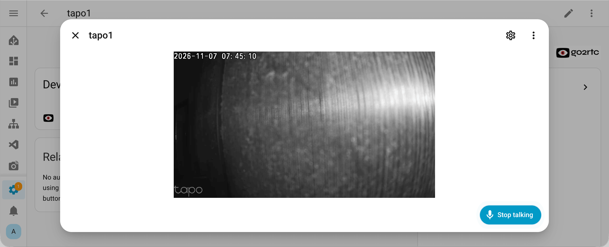

# go2rtc camera

This is a little temporary custom integration for testing cameras with two-way audio in Home Assistant.

This integration creates a [camera entity](https://www.home-assistant.io/integrations/camera/) that supports two-way communication. It works with the standard camera card in the Home Assistant interface.

## Installation

## Configuration

You can use go2rtc, which is built into Home Assistant. However, due to security restrictions, it only works with RTSP cameras.

Alternatively, you can use an external go2rtc. To do this, enter its address when configuring the integration, for example, `http://localhost:1984`.

## Tips

**Enable Two-way audio in Home Assistant**

[Settings > System > Labs](https://my.home-assistant.io/redirect/labs) > Two-way audio.

**Use HTTPS or Google Chrome (desktop or mobile)**

The browser enables the microphone only for HTTPS sites, but there is a way to bypass this.
Open `chrome://flags/#unsafely-treat-insecure-origin-as-secure` and add your `http://192.168.1.123:8123/`.
